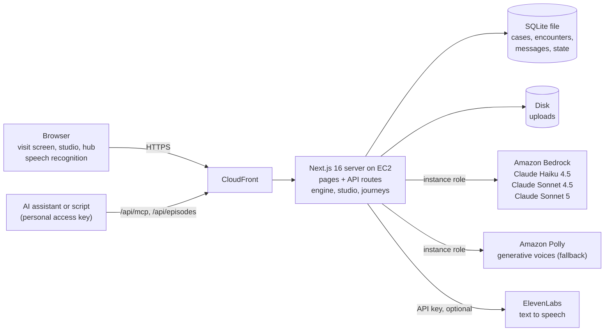
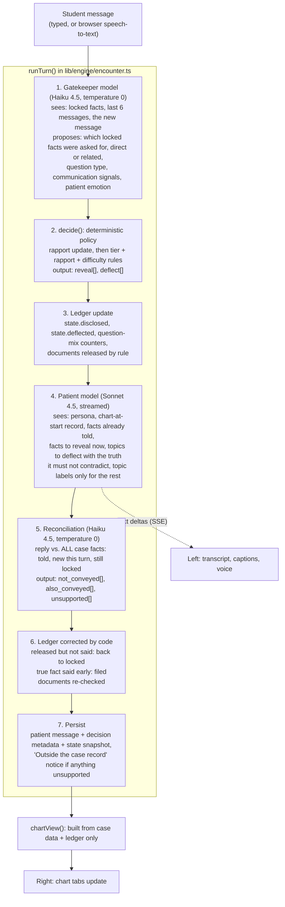

# Poscere: architecture

This document covers Challenge 1, "The Virtual Patient Encounter System", and the system as a whole.
The multi-encounter layer built for Challenge 2 has its own document,
[ARCHITECTURE-journeys.md](ARCHITECTURE-journeys.md); section 14 below explains how it reuses what
is described here.

It is written for an engineer who has not seen the code. File paths are relative to `src/` unless
they start with `data/`, `docs/` or `scripts/`. Numbers were read from the repository at the time
of writing.

## 1. The problem and the central decision

The brief asks for virtual patients that faculty can create without anyone writing patient-specific
code, a split screen with a chart that fills in as the student asks, a patient that does not invent
clinical facts, and feedback that can be explained.

A chatbot with a long system prompt containing the whole case fails three of those. The model can
reveal anything at any time, the chart has to be reconstructed by asking a model what was said, and
feedback on "what did the student find out" becomes a model's impression of a transcript.

Poscere separates the two jobs:

- **Deciding what is true and what is released is done by code, from case data.**
- **Deciding how it sounds is done by a language model that is only shown what has been released.**

The record of what was released (the disclosure ledger) then drives the chart, the feedback and,
in Care Journeys, the shared patient state. Everything else in this document follows from that.

## 2. System overview



One Next.js application (App Router, React 19, TypeScript) serves pages and API routes. State is in
one SQLite file through better-sqlite3. Model calls go to Amazon Bedrock through the Converse API
(`lib/llm.ts`). Speech goes to ElevenLabs when `ELEVENLABS_API_KEY` is set and to Amazon Polly
otherwise or on any ElevenLabs failure (`lib/tts.ts`, section 13). There is no separate backend
service, queue or vector store.

Three models are used, chosen by job (`MODELS` in `lib/llm.ts`, overridable by environment variable):

| Tier | Model | Used for | Why |
|---|---|---|---|
| `fast` | Claude Haiku 4.5 | Per-turn gatekeeper, order matching, reply reconciliation (audit), patient's memory of a visit | Runs on every turn, so latency matters; the tasks are classification over a short list |
| `chat` | Claude Sonnet 4.5 | The patient's voice; AI clinicians in Care Journeys; clarifying questions in the studio | Streams conversational text; needs to hold a persona |
| `smart` | Claude Sonnet 5 | Case drafting, clinical consistency review, guide patches, variants, feedback scoring, journey extraction and synthesis | Long structured output where quality matters more than speed |

Opus-class models were not available on the hackathon AWS account.

Structured output is obtained by forcing a single tool call whose input schema is the JSON Schema
we want (`chatJSON`). A response cut off by `max_tokens` is treated as an error rather than parsed.
Throttling and transient service errors are retried up to three times.

## 3. A case is data

A patient is one `CaseProfile` JSON document (`lib/types.ts`), stored in `cases.profile`. The main parts:

| Part | What it holds |
|---|---|
| `patient`, `persona` | Identity, appearance on camera, personality, communication style, health literacy, emotional state, a non-clinical biography, example lines, concerns |
| `scenario` | Student brief, chief complaint, the patient's opening line, tasks, time limit |
| `chartAtStart` | Record items visible before the first question |
| `facts[]` | Atomic pieces of history. Each has a non-revealing `topic` label, `chart` wording (clinician language), `says` wording (the patient's voice), a disclosure `tier`, an `importance`, and an optional `distractor` flag |
| `actions[]` | Exams, vitals, labs, imaging, tests, record reviews, each with a fixed `result` |
| `artifacts[]` | Chart documents: report text, tables with H/L/A flags, plotted series (line, bar, audiogram), or an uploaded image or PDF. Each has a `release` rule: `start`, `action` (when a given action is done) or `fact` (when a given fact is disclosed) |
| `objectives[]` | Learning objectives, each linked to the fact and action ids that demonstrate it |
| `answerKey` | Primary problem, differential, key findings, plan, red flags, education points |
| `mismatches[]` | Deliberate conflicts between what the patient says and what the record shows |
| `knowledge[]` | Faculty-supplied source text (guidelines, protocols, papers) |
| `variants[]` | Faculty-approved alternate versions for repeat practice |
| `rubricId`, `professions[]` | Which rubric scores it; which learner roles it is written for |

The engine in `lib/engine/` reads these fields and nothing else. There is no branch on a patient
name, a diagnosis or a specialty anywhere in it. That is what makes a patient created by a judge in
the Patient Studio runnable immediately: publishing changes a status column, and the next
`createEncounter()` reads the JSON.

Two consequences worth knowing:

- **Each encounter stores its own snapshot of the case** (`encounters.case_snapshot`). Editing a
  published patient affects new visits only; a visit in progress and its later feedback stay
  consistent with the case as it was.
- **A fact has two wordings on purpose.** The patient model is given `says`; the chart is written
  from `chart`. The chart therefore never contains model-generated text.

### Roles are data too

`data/professions.json` holds 63 roles in 10 groups. A role defines its scope, typical encounter
types, the kinds of action it uses, its note format, the fields of its written wrap-up and what the
rubric should emphasise. The case drafter is scoped by it, the patient is told what kind of
clinician it is talking to, the wrap-up form is built from it, and the feedback scorer is told what
is expected of that role (so a dietetics student is not marked down for not forming a medical
differential).

## 4. How a case is made and approved (Patient Studio)

Faculty can describe a patient in a paragraph, fill in a structured form, import a JSON profile, or
start from an empty profile (`components/studio/NewCaseWizard.tsx`).

1. **Clarify.** For a free-text description, a short call asks at most three questions, and only
   about things that would make two case writers produce clinically different cases
   (`clarify()` in `lib/studio/ai.ts`). If that call fails, drafting proceeds without it.
2. **Draft.** `generateCase()` in `lib/casegen.ts` runs a staged pipeline (`generateStaged()`),
   every stage on the `smart` model with a forced schema:
   1. **Outline**, one short call. It fixes the title, who the patient is, how they talk, the reason
      for the visit, and a 300 to 450 word clinical story that states every specific that must
      agree across the case: timeline, each medication with dose and how it is really taken, vitals,
      each lab value with units, exam findings, relevant negatives, what the patient is slow to
      admit, the patient-versus-chart mismatches and the red herrings.
   2. **Four calls in parallel**, each given the outline and told not to change any name, value or
      date in it: (a) faculty summary, persona, the scenario the learner sees and the answer key;
      (b) the medical half of the facts (presenting complaint, history, review of systems,
      medications, allergies; 18 to 22 facts); (c) the personal half (family, social, substance,
      nutrition, function, psychosocial, goals, adherence; 14 to 18 facts); (d) the chart-at-start
      items, the exams and orders with their fixed results, and the chart documents.
   3. **Linking**, one short call. It is shown the facts, actions and documents that now exist, with
      their ids, and writes the learning objectives and the mismatches against those ids.

   A stage whose output fails a minimum check (for example fewer than 8 medical facts, or no
   documents) is retried once. If the staged pipeline fails, the previous single-call generator
   (`generateSingle()`) runs as the fallback. An uploaded source document is passed as guidance and
   attached as a knowledge source.

   Why staged: the earlier design was one call, chosen so that history, medication list, lab tables
   and answer key were written together and agreed. It took two to four minutes and sometimes
   dropped a section. The outline now carries the agreement instead: every number is decided once,
   before any list is written, and the list writers copy from it. Drafting takes about 80 seconds.
   The cost is that the four parallel writers do not see each other's output, so a detail the
   outline did not fix can still differ between, say, a fact and a document; that is one of the
   things the consistency check in step 6 looks for.

   The case-writing rules in the system prompt apply to every stage. Three are recent additions:
   - **No diagnosis in what the learner sees.** The title, summary and answer key are for faculty.
     The student brief and tasks must not name the diagnosis, the hidden problem or any finding
     ("Take a focused history of the presenting concern", not "Identify medication overuse
     headache"). Chart-at-start items, documents released at the start and action results must not
     reveal a reluctant or guarded fact either. `scripts/scrub-briefs.ts` applied the same rule to
     the existing seed cases.
   - **Chart wording records what the patient reports**, in clinician language, and never the
     hidden truth. If the patient under-reports, the fact reads "Reports taking sumatriptan 10-12
     days a month" and the real figure lives only in a document; that gap is the mismatch.
   - **Actions are things the learner does or reviews** (an examination, a measurement, a named
     screening instrument, a record review), never an interview question.
3. **Normalise.** `normalizeCase()` repairs ids, removes references to items that do not exist,
   repairs release rules that point nowhere and makes action-to-document links symmetrical, so the
   engine can trust the profile.
4. **Store as a draft** with `origin = 'ai_draft'` and `reviewed = 0`. The interface shows
   "AI-drafted, not faculty-reviewed" on such a case everywhere it is listed, including to students,
   until a faculty member marks it reviewed.
5. **Edit.** Every part has a form editor. The guide (`guide()` in `lib/studio/ai.ts`) takes a
   request in plain language and returns a **patch**: a list of `set`/`add`/`remove` operations on
   dot paths (`lib/studio/patch.ts`). Patches are validated against the current case, shown as a
   before/after diff, and applied only when the faculty member accepts. No model output is written
   to a case without that step.
6. **Check consistency.** Two layers:
   - Deterministic rules (`runRuleChecks()` in `lib/studio/checks.ts`): missing brief or name, no
     volunteered chief concern, facts missing a wording, duplicate facts, objectives linked to
     nothing, documents whose release rule can never fire, tables whose rows do not match their
     columns, broken mismatch and variant links, a rubric that no longer exists.
   - A model review (`modelCheck()`): compares every place the same clinical information appears
     (doses across facts, medication list and chart header; lab values across results, tables and
     trend charts; dates; the answer key against what the facts support; the student brief against
     what is meant to be discovered) and reports contradictions with a severity and a proposed patch.
   Results are stored with a hash of the profile they were run on, so the publish dialog can say
   when the case has changed since the last check.
7. **Publish.** `POST /api/cases/:id/status`. Structure rules are re-run at that moment. Publishing
   is refused while high-severity issues are open unless the faculty member acknowledges them. The
   dialog states whether the clinical review has run and whether it is stale, and offers a tick box
   to mark an AI-drafted case as faculty-reviewed.

Trade-off: the consistency check establishes that a case agrees with itself. It does not establish
that the medicine is right. That is the faculty member's review, and the label exists to show
whether it has happened.

### Students can make their own practice patient

`POST /api/practice` (the card "Make your own practice patient" on the student Practice page). The
student describes a patient or a skill in a sentence or two and picks a level; the same
`generateCase()` drafts a case for the student's own profession and a practice visit starts on it.
The case is stored as a draft owned by the student (`origin = 'ai_draft'`, `reviewed = 0`). It is
never published, it is not in the practice library or in any faculty member's Studio library, and
the student sees only the visit, not the case file. Nobody reviews it: there is no clarify step, no
consistency check and no faculty approval, and the page says so ("Private to you. Written by AI and
not reviewed by faculty.").

### What students see of a case

Case titles and summaries are written for faculty and usually name the diagnosis. Student-facing
pages and API responses use a label built by `lib/courses/label.ts` from the patient's first name
and age, the kind of visit and the specialty ("Denise, 41 · Diagnostic interview · Neurology").

## 5. The per-turn pipeline



Step by step, with the reasons.

**1. The gatekeeper proposes.** `gatekeep()` in `lib/engine/gatekeeper.ts` gives a fast model the
still-locked facts (id, category, topic, content), the last six messages and the student's new
message. It returns which locked facts a truthful answer would include, each marked `direct` (the
student asked about that topic) or `related` (an open question the fact would naturally come up
in), plus the question type (open, focused, closed, leading, multiple) and nine communication
signals (introduced self, explained purpose, empathy, validated emotion, sensitive framing,
judgmental, dismissive, jargon, rushed). It is the only component that needs language understanding
to map "do you ever have a drink?" onto the fact about alcohol. If the call fails it **fails
closed**: no matches, nothing new is disclosed.

**2. Code decides.** `decide()` is a pure function. First it updates rapport (0 to 100) from the
signals: introducing yourself +4, explaining the purpose +3 (both only in the first few turns),
empathy +6, validating emotion +5, sensitive framing +5, an open question +2; judgmental -10,
dismissive -7, unexplained jargon -2 (or -5 for a patient with low health literacy), rushed -4,
stacked questions -2, a leading question -1. The change is clamped to 12 points per turn. Then it
applies the tier rule to each proposed fact, direct matches first:

| Tier (studio label) | Released when |
|---|---|
| `initial` (Volunteered) | Whenever it is matched, directly or by an open question |
| `discoverable` (When asked) | On a direct question; or on a related one when the difficulty level lets the patient volunteer |
| `reluctant` (Needs trust) | On a direct question **and** rapport at or above the level's threshold. The threshold drops 6 points if the patient has already deflected this topic once, and 8 points if the question was framed sensitively. Otherwise the fact goes to the deflect list |
| `hidden` (Guarded) | Same shape with a higher threshold (drops 5 for an earlier deflection, 8 for sensitive framing) |

No more than `factsPerTurn` facts are released in one reply. Distractor facts exist only when the
difficulty level turns them on. If an open question matched nothing, up to two volunteered facts are
released so "what brings you in?" always gets an answer.

The model can therefore propose anything it likes; a guarded fact still does not come out until the
student has earned it, and the reason it did or did not come out is a number that can be shown.

**3. The ledger is updated** before the patient speaks: `state.disclosed[factId] = { turn, how }`,
deflection counts, question-mix counters, and any document whose release rule now fires. This entry
is provisional until step 5 has checked what the patient actually said.

**4. The patient speaks.** `patientSystem()` in `lib/engine/patient.ts` builds the prompt for this
one turn: who the patient is, how they feel now (from rapport and the gatekeeper's emotion),
difficulty and variation instructions, and then five lists:

- **What is on the record** (`chartAtStart`): the items the clinician can already see in the chart.
  The patient is told they know these too and that what they say must agree with them; asked to read
  a pill bottle or a dose, they give exactly what is there or say they do not have it to hand.
- **What they have already told**, in `says` wording.
- **What they share in this reply**, in `says` wording, with the instruction to say each one.
- **What they are not ready to admit**: the topics being deflected this turn, each with its `says`
  wording marked as the truth they are keeping to themselves. The purpose is to stop a patient who
  is told only to dodge "alcohol use" from inventing a reassuring figure that contradicts the fact
  when it is finally released. The instruction is to say less, never something false: no amount,
  frequency, name or detail that differs from the truth.
- **Topic labels only** of the remaining locked facts, so the patient stays non-committal on them
  instead of denying them.

So the wording of a locked fact reaches the patient model in exactly one case: the student has asked
about it directly and the policy has refused it this turn. For every other locked fact the model has
the topic label and nothing else. The hard rules tell it that its medical story is exactly those
lists: asked about any other symptom, drug, result or family history, the true answer is no or "I
don't know". The reply streams to the browser as server-sent events and to the voice a sentence at
a time.

**5. The reply is reconciled with the case.** `auditReply()` in `lib/engine/gatekeeper.ts` gives a
fast model the finished reply and **all** the case facts in three lists (already shared, new this
turn, not yet shared), each with its chart and patient wording, plus the non-medical background, the
chart-at-start record, and allowed context (the patient's memory of earlier visits and what the
student just said, so the patient repeating a clinician's words is not flagged). It returns:

- `not_conveyed`: facts released this turn whose substance the reply did not communicate;
- `also_conveyed`: still-locked facts the reply stated with their specifics anyway (a vague or
  played-down version does not count);
- `unsupported`: concrete clinical details asserted as true that are in no case fact, or that
  contradict one (a different drug, dose, amount, frequency, symptom, diagnosis, result or family
  history). Denials, "I don't know", feelings, non-medical life details and rewordings are excluded.
  At most three are kept.

Ids the model returns that are not in the corresponding list are discarded.

**6. Code corrects the ledger** from that result (`runTurn()`): a `not_conveyed` fact is removed
from `state.disclosed` and is locked again, so it is not shown in the chart or counted as elicited;
an `also_conveyed` fact is filed as disclosed this turn (it is a true case fact, and otherwise
feedback would later call it missed); document release rules are run again. Unsupported claims are
stored on the message and shown to the student as a notice in the transcript: "Outside the case
record: ... The simulated patient went beyond the approved case here. Treat it as unverified; it is
not filed in the chart."

**7. Everything is persisted**, including a snapshot of the encounter state on each patient
message. If the patient model fails mid-stream the turn is rolled back, so nothing is recorded as
disclosed that the patient never said.

Limits of steps 5 and 6: the audit runs after the text has streamed, so the student has already read
the sentence when a notice appears, and the chart updates only when the audit returns. The auditor is
a model and can be wrong in either direction. If the audit call fails it returns empty lists:
nothing is flagged and the ledger stays as the policy set it in step 3.

**The chart.** `chartView()` builds the right-hand side from the case and the ledger and from nothing
else: disclosed facts in their `chart` wording grouped by category, results of actions done,
documents released, and an activity log in turn order. It is also the only view of a case the
student's browser ever receives; the profile, undisclosed facts and the answer key stay on the server.

## 6. Clinical grounding: what is guaranteed and what is not

Stated as precisely as the code allows.

**Guaranteed by construction**

- Clinical findings and results written to the chart are the case's own text, verbatim: the `chart`
  wording of a fact, the `result` of an action, the documents in the case. No model writes to the
  chart during a visit. (That text is faculty-approved only if a faculty member reviewed the case;
  see "Not guaranteed". On a class-shared patient the chart also holds earlier students' write-ups
  as notes, labelled with the author and role; those are student text, not case text.)
- An exam, test or record request can only return the `result` of an action in the case (section 7).
- A document appears only when its release rule fires.
- A fact can only be filed in the chart if it is a fact of the case. The reconciliation step can
  add or remove ledger entries, but only by id from the case's own fact list.
- The patient model is not given the content of a locked fact unless the student has asked about it
  directly and been refused this turn (step 4). For all other locked facts it has the topic label,
  which is written to be non-revealing.
- What counts as elicited or missed in feedback is read from the ledger (section 10).
- If the gatekeeper is unavailable, nothing is disclosed.

**Not guaranteed**

- **The patient's wording.** The patient model is constrained by its prompt, not by a filter. It can
  still add a symptom, a number or a family history that is not in the case, most often when asked a
  leading closed question. The reconciliation step is a second model that catches such claims and
  flags them as "Outside the case record"; it can miss one or flag something harmless. The flag is
  added after the reply has streamed, so the student has already read the sentence. If the audit
  call itself fails, nothing is flagged for that turn. Unsupported statements never reach the chart,
  the ledger or the elicited list.
- **That a deflected fact stays unsaid.** When a topic is deflected, its true wording is in the
  prompt so the patient does not contradict it. The model is told not to admit it, and can still
  do so. If it states the specifics, the reconciliation step files the fact (the student did hear
  it); the tier rule was then bypassed for that fact by the model, not by the student's skill.
- **That the ledger matches what was spoken.** The policy's release is checked against the reply
  and corrected (steps 5 and 6), which closes the gap the earlier design left open. The check is a
  model's reading of one reply, so a fact can still be recorded as disclosed when it was only
  hinted at, or sent back to locked when it was said. When the audit call fails, the ledger records
  what the policy released, unchecked.
- **The gatekeeper's matching.** It can miss a fact the student did ask about (the fact stays locked
  and may be reported as missed) or match one the student only brushed against. The policy limits
  the damage of over-matching for reluctant and guarded facts; it does not for volunteered ones.
- **That the case is clinically correct.** Grounding is to the approved profile. If the profile is
  wrong, the patient is consistently wrong.
- **Knowledge sources are not retrieved during the conversation.** They are given to the case
  drafter, the consistency review (first 1,500 characters each) and the feedback scorer (first
  6,000 characters each). The patient does not read them, and there is no vector search.

## 7. Orders and exams

The student types a free-text request in the Results & orders tab ("lipid panel and an ECG").
`matchActions()` gives a fast model the request and the case's list of actions (id, kind, name,
aliases) and asks which it clearly means; ids it returns that are not in the case are discarded.
`runAction()` then:

- records each matched action in `state.actions` and returns its fixed `result` text, marking
  abnormal ones;
- releases any documents tied to those actions (a lab order brings its lab report into Chart review);
- answers anything unmatched with "no approved result is available for this in the case file" and
  records it, so feedback can list "Requested but not part of this case".

The model's only job is to recognise that "CBC" means "Complete blood count". No result text is
generated. Because every visit is framed as a telehealth call, physical exams are written into
cases as guided remote exams with a fixed finding.

## 8. Difficulty and variation

Difficulty never changes the clinical facts. It changes how hard the patient is to interview
(`knobsForLevel()` in `lib/engine/difficulty.ts`):

| Level | Starting rapport | Reluctant at | Guarded at | Facts per reply | Volunteers related facts | Vagueness (0-3) | Emotion (0-3) | Distractors | Hints | Time limit |
|---|---|---|---|---|---|---|---|---|---|---|
| 1 Foundational | 62 | 55 | 70 | 4 | yes | 0 | 0 | no | yes | none |
| 2 Developing | 55 | 60 | 74 | 3 | yes | 1 | 1 | no | yes | none |
| 3 Proficient | 48 | 64 | 78 | 3 | no | 1 | 1 | yes | yes | case limit + 5 min |
| 4 Advanced | 42 | 68 | 82 | 2 | no | 2 | 2 | yes | no | case limit |
| 5 Expert | 36 | 72 | 86 | 2 | no | 3 | 3 | yes | no | case limit - 5 min (at least 8) |

At level 1 the patient already trusts the student enough to share reluctant facts when asked
directly; at level 5 the student has to gain 36 points of rapport first, two facts at a time, from
a vague and distressed patient.

Three further sources of variation, all of which keep the answer key valid:

- **Persona variations** (`PERTURBATIONS`, 7 of them: in a hurry, more anxious, talkative, withdrawn,
  skeptical, family pressure, having a bad day). Each is an extra instruction to the patient model
  about mood and delivery and, for some, a small change to rapport or facts per reply. On repeat
  attempts one is chosen by attempt number, so a student who memorised the last transcript still
  has to listen.
- **Variants.** A faculty-approved set of overrides on persona, fact wording or tier, and results
  that no document reports. Drafted by the model on request, inactive until approved, applied to a
  copy of the case when an encounter is created.
- **Exam mode** turns hints off and hides the comfort meter.

Practice-mode hints (`hint()` in `lib/engine/encounter.ts`) are computed without a model from the
ledger and the question-mix counters, and never state the content of a fact.

## 9. The adaptive learner model

`lib/adaptive.ts`. No language model is involved in choosing what comes next.

Each student has one rating per (profession, rubric domain), starting at 1200. Each difficulty level
plays at a fixed rating: level 1 = 1000, 2 = 1150, 3 = 1300, 4 = 1450, 5 = 1600. After a scored
visit, for each rubric domain that received a score:

```
expected = 1 / (1 + 10^((levelRating - rating) / 400))
outcome  = (domainScore - 1) / 3          # rubric score 1..4 mapped to 0..1
K        = max(48, 160 / sqrt(n + 1))     # n = scored visits so far in this domain
rating   = rating + K * (outcome - expected)
```

This is the Elo update with the patient's difficulty level in the place of the opponent. K starts
at 160 so the first few visits move the rating quickly and falls toward 48 as evidence accumulates.
Every update is written to `skill_events` (level, outcome, expected, before, after), which is what
the Progress page plots and which makes the update idempotent per encounter.

Choosing the next session (`recommend()`):

1. Overall rating = mean of the domain ratings.
2. Level = the level whose expected outcome for that rating is closest to 0.70. A student with no
   history starts at level 2.
3. The weakest domain biases the patient's behaviour: for example, weak rapport or cue-response
   gets a more emotional, more guarded patient; weak information gathering gets a vaguer patient
   who volunteers nothing; weak clinical reasoning gets a case with distractors.
4. The case is the published case for the student's profession with the lowest cost, where
   cost = 3 x (times already completed) + |case difficulty - level|.

The student is shown the reason in words, including the expected score.

Trade-offs: the input is the rubric score, which comes from a model (section 10), so the rating
inherits that noise; the constants are reasoned defaults and have not been calibrated against real
students. Only 4-point domain rubrics feed the model; checklist rubrics do not. The behaviour bias
is keyed to the default rubric's domain keys, so a custom rubric gets level selection but a
balanced patient.

## 10. Feedback

`scoreEncounter()` in `lib/engine/feedback.ts`. It has a deterministic half and a model half, and
where they overlap the deterministic half wins.

**From the ledger, no model**

- Findings elicited (with the turn each came out) and findings missed, most important first.
  Distractors are excluded. A missed fact the patient deflected is marked "you asked; the patient
  was not ready to say".
- Exams and orders done, important ones not done, and requests that had no approved result.
- For each learning objective that is linked to facts or actions, a ledger status: met if all were
  obtained, partial if some, not met if none. This is one of two inputs to the objective's final
  status (see "Verification by code").

**From the scoring model (Claude Sonnet 5)**

The prompt contains the student's role and what is expected of it, the tasks, the answer key, the
knowledge sources, the learning objectives, the rubric with its descriptors, the ledger results
above marked as authoritative, the question-mix counts, the rapport history, the full transcript
with turn numbers, and the student's written wrap-up. The schema requires, for each rubric domain,
a score, a rationale and one to three evidence items, each with a turn number and an exact quote.
It also returns interview structure, sequencing and question mix; strengths and improvements;
safety concerns; clinical accuracy issues, judged only against the answer key and the knowledge
sources; whether each built-in patient-versus-chart mismatch was noticed; a review of the wrap-up;
and three to five concrete actions for the next attempt.

**Verification by code**

- Each quoted piece of evidence is looked up in the transcript (`groundEvidence()`). If it is in the
  stated turn it is kept. If it is found in a different turn the turn number is corrected. If it is
  not found anywhere the quote is removed and only the note is kept. The score for that domain is
  not changed by this step; what is prevented is a fabricated quote being shown as evidence.
- **A scoring reply without scores is a failure, not a zero.** If the model returns fewer than two
  usable domain scores, the call is repeated, up to three attempts in all. If the third also fails,
  scoring throws, the visit stays submitted with its transcript and write-up, and the student can
  press **Score this visit** to try again. Earlier this case was stored as 0/0.
- **An objective is met only when the ledger and the examiner agree.** The ledger shows that the
  information came out; the examiner judges whether the skill was shown. The final status is the
  lower of the two (not met < partial < met), so the label never contradicts the comment beside
  it. An objective linked to nothing uses the examiner's status alone; the studio warns about such
  objectives.
- Scores are clamped to the rubric's range. Total and maximum are summed over the domains that
  received a score (domains marked not applicable are left out of both), and the percentage is
  `round(total / max * 100)`.
- The visit is flagged for instructor review if a domain marked as review-triggering scores 1 or if
  any safety concern is raised.

The default rubric is the provided Patient Encounter Performance Rubric
(`data/rubrics/encounter_evaluation_rubric.json`): seven domains scored 1 to 4 (opening and purpose;
rapport, respect and empathy; information gathering; listening and response to cues; explanation
and shared decisions; clinical reasoning and synthesis; professionalism, safety and closure). The
last two trigger review at a score of 1. A second built-in rubric is a 12-item, 100-point checklist
from the provided pediatric hearing simulation. Faculty can add rubrics of either shape.

Every encounter is logged: the `encounters` row holds configuration, final state, the case
snapshot, the wrap-up, the feedback JSON and the score; `messages` holds every line with the
decision metadata for that turn. Faculty can add a note and an adjusted score, and for exams
feedback can be held until released.

Trade-off: the rubric scores are a model's judgement and have not been compared with human raters.
The design reduces how much rests on that judgement (ledger for findings and objectives, quote
verification, review flags, a faculty override), but it does not remove it.

### The running score, turn by turn

`timeline()` in `lib/engine/timeline.ts`. It is arithmetic over what is already stored with each
patient message (the state snapshot, the gatekeeper's signals and question type), so it needs no
model call and exists while the visit is still in progress. For each turn:

```
weight        critical = 3, important = 2, minor = 1
coverage      = weight of findings disclosed + non-minor exams/orders done
                / weight of all findings (distractors excluded) + all non-minor exams/orders
expected      = min(0.8, turn / 12 * 0.8)          # a steady interview reaches 80% by turn 12
pace          = min(1, coverage / expected)

mark          = 0.6
                + 0.25 empathy or validated emotion   + 0.15 sensitive framing
                + 0.10 open question                  + 0.10 introduced self
                - 0.45 judgmental   - 0.35 dismissive - 0.20 jargon   - 0.20 rushed
                - 0.15 stacked questions              - 0.10 leading question
                clamped to 0..1
communication = mark on the first turn, then 0.6 * previous + 0.4 * mark
comfort       = rapport / 100

score         = 0.45 * pace + 0.35 * communication + 0.20 * comfort
```

It is shown in two places: on the feedback page as "The visit, turn by turn" (four lines: running
score, findings covered, communication, patient comfort, with a per-turn note such as "empathy, 2
new findings" linked to the transcript), and in the instructor's Live Visits console while the visit
is running. During the visit it is returned to faculty only; the student sees it afterwards.

It is a different number from the rubric score and does not feed it, the gradebook or the adaptive
rating. The weights are reasoned defaults, not calibrated values, and the inputs are the
gatekeeper's per-turn classifications, so it inherits their errors.

## 11. Memory within a visit, across attempts and across visits

- **Within a visit.** The patient model receives the full student/patient history plus the list of
  everything it has told, every turn, so identity and story stay consistent. Rapport and emotion
  carry forward in `EncounterState`.
- **Rewind.** Each patient message stores a snapshot of the state. In practice mode a student can
  go back to an earlier turn; this creates a new encounter branched from that snapshot
  (`rewind()`), so they can try the same moment differently. Branches do not move the adaptive rating.
- **Attempts.** `attemptHistory()` compares scored attempts at the same case: domain scores, what was
  new this time, what was found last time and not this time.
- **Start over or follow up.** After a scored visit the student has two choices, on the practice
  library and on the feedback page. **Start over** is a clean repetition: a new encounter with an
  empty ledger and the level's starting rapport, optionally with a persona variation. **Follow-up
  visit** (`followUp` in `createEncounter()`) continues the relationship.
- **What a follow-up carries.** When a visit is scored, `rememberVisit()` in
  `lib/engine/feedback.ts` writes a row in `patient_relationships` for that student and patient:
  the visit count, the fact ids disclosed, the actions done, the final rapport, and a short
  first-person memory written by the fast model from the transcript ("Only use what was actually
  said"), appended to the memories of earlier visits. A follow-up visit starts with those facts
  already in the chart as "on record", earlier results and their documents present, rapport carried
  over (clamped to 15 to 85), a brief that says it is a follow-up, and the memory in the patient's
  prompt with an instruction to greet the student as someone they know and not to retell the whole
  story. A student who was dismissive last time meets a less trusting patient. Follow-ups are for
  self-started practice; assignment visits do not use them, and care-journey visits carry
  continuity through the journey's own shared state.

### One patient shared by a class

An assignment (homework or practice, not an exam) can turn on **One shared patient for the class**
(`sharedPatient` in `lib/courses/settings.ts`). Every student's visit on that assignment is then a
visit to the same continuing patient, using the same mechanism as a follow-up with the relationship
keyed to the assignment instead of to one student (`teamScope = "team:<assignmentId>"`):

- **The patient's state continues.** Facts disclosed and tests done in earlier students' scored
  visits are on record for the next student, and trust carries over, good or bad.
- **The patient remembers each student by name.** `rememberVisit()` writes each memory as "Visit N
  with <name> (<role>)". The prompt tells the patient that the person on this call is probably new,
  that they expect the team to talk to each other, and that if this person says something that
  conflicts with what an earlier person told them they should say so and name that person.
- **Earlier write-ups are in the chart.** `addTeamNotes()` adds each earlier scored visit's written
  wrap-up to this visit's copy of the case as a note document titled "Visit N note: <role>", with
  the student's name as author, available from the start.
- **Each student acts in their own profession**, whatever the case was written for: the role in the
  patient's prompt, the wrap-up form and the scorer's expectations come from the student's own
  profession.
- **Teammates can read each other's visits** on that assignment through the Episodes page
  (section 17).

Limits: the shared record is updated when a visit is scored, so two students who are in the room at
the same time do not see each other's findings; visits are meant to be taken in turn. The case
content is still one case written for one profession, so a second profession can only uncover what
that case contains. The conflict the patient points out depends on the fast model's memory summary
having kept the advice and on the patient model acting on the instruction; neither is checked by
code. This is a lighter mechanism than a Care Journey: no shared patient state with provenance, no
SBAR and no AI colleagues.

## 12. Live instructor assist

For assignments with live assist turned on, students are told in the waiting room that an
instructor may watch. `GET /api/live` lists such visits that are active or paused, with at-risk
flags computed from state without a model: comfort below 30, comfort fallen 15 or more points,
two or more judgmental or dismissive moments, six turns with two or fewer facts gathered, two or
more deflected topics. The console (`components/courses/LiveConsole.tsx`) refreshes every three
seconds and shows the transcript and chart so far. The instructor can pause the visit with a note
(the student sees an overlay and cannot send messages) and can send a coaching note that appears in
the student's transcript labelled "Instructor". Both are stored as messages, so they are part of
the record the scorer and later reviewers see. The console also shows the running score for the
visit so far (section 10).

**The visit clock.** A visit's clock starts when the student leaves the waiting room
(`POST /api/encounters/:id/start` sets `started_at` at that moment, not when the visit was
created). While an instructor has the visit paused the clock is stopped, and on resume the pause
route moves `started_at` forward by the length of the pause, so paused time does not count against
a time limit.

## 13. Voice and the "video call"

- **Student speech** uses the browser's `SpeechRecognition` API (Chrome, Edge, Safari). A final
  transcript is sent as a normal message. Recognition is paused while the patient is speaking and
  restarted after silence. Where the API is missing the microphone control is disabled.
- **Patient speech** (`speak()` in `lib/tts.ts`). When `ELEVENLABS_API_KEY` is set, speech comes
  from ElevenLabs with the flash model (`eleven_flash_v2_5`, overridable with `ELEVENLABS_MODEL`).
  The voice is picked from pools grouped by sex and age band (women under and over 38; men under
  32, 32 to 61, and 62 and over) and then by a hash of the patient's name, so a 72-year-old does
  not sound 25 and a patient always sounds the same. On any ElevenLabs error or a 12-second
  timeout, and whenever no key is set, the same sentence is synthesised by Amazon Polly with the
  generative engine, with the voice chosen by sex and name hash. Audio is cached in memory per
  speaker and sentence.
- **Sentence by sentence.** The visit screen (`components/visit/Visit.tsx`) sends each finished
  sentence to `POST /api/tts` as the reply streams and plays the clips in order, so the patient
  starts talking before the reply is complete.
- **The patient on screen** is a still portrait in a call frame with a speaking state, captions and
  the comfort meter. It is not lip-synced or animated. The student's camera, if turned on, is a
  local self-view only.

## 14. How Care Journeys reuse the engine

Challenge 2 is built on top of this engine without a second patient implementation. A stage of a
care journey is an ordinary encounter created by the same `createEncounter()` with two extra inputs:

- `initialDisclosed`: fact ids disclosed in earlier stages, which enter this encounter's ledger as
  already on record, appear in the chart, and are in the patient's "what you have already told";
- `journey`: the shared-state context for the clinician and a model-free patient's-eye memory of
  whom they have already seen.

AI clinicians do not get a private channel to the patient. Each line an AI clinician says is passed
to the same `runTurn()` a student's message goes through, so the gatekeeper and the tier rules
decide what that clinician learns, and each check goes through the same `runAction()`.

After every stage, the ledger described in section 5 is converted deterministically into entries
in the shared patient state with provenance. That is why a patient statement or a lab value can
only enter the shared state if it is in the case file. Clinicians' assessments and recommendations
are extracted separately by a model and verified against quotes.

The shared state, relations, SBAR evaluation, huddle and care-plan synthesis are described in
[ARCHITECTURE-journeys.md](ARCHITECTURE-journeys.md). The two documents describe one system: this
one stops at the single encounter and its ledger; that one starts there.

## 15. Data model

SQLite, one file, WAL mode. Structured values are JSON in TEXT columns, which keeps the schema small
while the case format is still changing. Core tables are in `lib/db.ts`; additions are in `lib/schema/`.

| Table | Holds |
|---|---|
| `users` | Account, role (`faculty`, `student`, `admin`), profession |
| `cases` | `profile` (CaseProfile JSON), `owner_id`, `status` (draft, published, archived), `origin` (faculty, sample, ai_draft), `reviewed`, last `consistency` result |
| `rubrics` | Custom rubrics |
| `uploads` | Uploaded files and the text extracted from them |
| `courses`, `enrollments`, `assignments` | Courses with join codes; homework, exam and practice assignments with their settings |
| `encounters` | One visit: `config`, `state`, `case_snapshot`, `wrapup`, `feedback`, `score`, faculty note and adjusted score, `parent_id` for rewound branches, `started_at` and `paused_at` for the clock |
| `messages` | Every line of every visit with speaker, turn and decision metadata |
| `skill_ratings`, `skill_events` | The adaptive model: current rating and its full history |
| `patient_relationships` | Per student and patient (or per assignment and patient, for a class-shared patient): visits, rapport, disclosed facts, actions, memory |
| `api_keys` | Personal access keys for the episode API and the MCP endpoint |
| `journeys`, `clinicians`, `journey_runs`, `journey_stage_runs`, `state_entries`, `state_links`, `handoffs`, `team_messages` | Care Journeys; see the journeys document |

Sessions are a signed cookie (HS256 JWT, 14 days); passwords are hashed with bcrypt (`lib/auth.ts`).

Trade-off: SQLite with synchronous access makes every read-modify-write of encounter state simple
and atomic within one process, which suits a single instance and a hackathon. It rules out running
more than one application server. Moving to PostgreSQL would be a change to `lib/db.ts` and the SQL
strings; the JSON columns map to `jsonb`.

## 16. Deployment

- One EC2 instance runs the Next.js server; CloudFront in front provides HTTPS at
  `https://d3k6ssmfceay1x.cloudfront.net`.
- The server reaches Bedrock and Polly through its instance role. No AWS keys are stored on the
  server; locally the same code uses credentials from `.env.local`. The ElevenLabs key, when used,
  is an environment variable.
- A systemd timer on the server polls the `main` branch of the GitHub repository every minute. Each
  new commit is built in its own release directory (`npm ci`, `npm run build`); only when the build
  succeeds is the `current` link repointed and the service restarted. A failed build is recorded
  and skipped, leaving the previous release running. `GET /api/health` reports the running commit.
- On the running server the build is run at low CPU priority so that visits in progress keep
  responding while it runs (this setting was made on the instance and is not yet in
  `infra/userdata.sh`). The switch itself is a restart of about two seconds (the unit is given 4
  seconds to stop and restarts after 1). A restart still drops any reply that is streaming and any
  care-journey worker running in the process, so pushing during a demo is not advised.
- `scripts/ship.sh` is the developer side: it type-checks and runs a production build locally and
  only then commits and pushes, so a commit that cannot build is not offered to the server.
- CloudFront closes a connection that is silent for 60 seconds, and case drafting, scoring and
  care-plan synthesis take longer than that. Those routes return through `longJson()`
  (`lib/http.ts`), which sends a whitespace heartbeat every 8 seconds and then the JSON body;
  leading whitespace is valid JSON, so the client code is an ordinary `await res.json()`. Patient
  replies and care-journey progress use server-sent events.
- `DB_PATH` and `UPLOAD_DIR` let the database and uploaded files live outside the per-commit
  release directories, so a new release does not replace them.

The files used to create all of this are in `infra/`: `provision.sh` (the AWS CLI commands in
order: instance role and profile, key pair, security group, instance, Elastic IP, CloudFront
distribution), `userdata.sh` (instance bootstrap: Node, the environment file, the systemd service,
the deploy script and its timer), `ec2-trust-policy.json` and `cloudfront.json`. They are plain
AWS CLI scripts, not a template, and the hackathon AWS account they were run on is temporary.

## 17. Episodes, privacy and the integration API

An **episode** is the stored record of one visit: who the patient was, who the professional was and
in which role, the transcript, what was disclosed, the results, the write-up and the score.
`lib/episodes.ts` is the one module that searches them, and three surfaces share it.

**Who can see what** (`visibleClause()` in `lib/episodes.ts`; the same rule for acting on a visit
is in `lib/access.ts`):

| Visit | The student | Faculty | Other students |
|---|---|---|---|
| Self-started practice, including on a patient the student made | yes | no | no |
| Assignment visit | yes | yes | no |
| Assignment visit on a class-shared patient | yes | yes | students enrolled in that course |
| Care-journey visit | yes | yes | no |
| A faculty member's own test visit | n/a | that faculty member | no |

The visit screen and the feedback page label each visit accordingly: "Private practice" (only the
student sees the visit and its feedback; it still updates their own progress) or "Recorded for
instructor". Faculty cannot open a student's private practice by guessing its URL: the encounter
routes, the feedback page and the episode search apply the same test. Rewound branches and
abandoned visits are not listed. Case titles are returned to faculty only, and feedback an
instructor is holding is not returned to the student.

**The three surfaces**

- **The page** `/episodes` ("Episodes" for faculty, "My visits" for students): search by patient
  name, by who took part, by role, or by words said in the visit or written in the write-up. A text
  search shows the first matching transcript line.
- **REST**: `GET /api/episodes?patient=&participant=&role=&text=&caseId=&limit=` searches (newest
  first, at most 100), and `GET /api/episodes?id=<episodeId>` returns one episode in full.
  Authentication is the session cookie or a personal access key.
- **MCP**: `POST /api/mcp` (`app/api/mcp/route.ts`) is a Model Context Protocol server over
  Streamable HTTP, stateless, answering each JSON-RPC request with a JSON response (no event
  stream; `GET` returns 405). It implements `initialize`, `ping`, `tools/list` and `tools/call`
  with four tools:

  | Tool | Returns |
  |---|---|
  | `search_episodes` | Episode summaries filtered by patient, participant, role, transcript text or case id |
  | `get_episode` | One episode: transcript by turn, disclosed findings, results, write-up, feedback summary |
  | `list_patients` | Patients in the library: for students, published ones without titles |
  | `get_patient_record` | For faculty the whole case, answer key included; for students only what is in the chart before the first question |

  An assistant that speaks MCP can therefore answer "find the visits where a nursing student asked
  Walter Greene about alcohol" against the store, with the key owner's permissions.

**Personal access keys** (`lib/apikeys.ts`, `/api/keys`, managed at the bottom of the Episodes
page). A key is `rk_` followed by 32 random characters, is shown once when created, is sent as
`Authorization: Bearer <key>`, resolves to its owner's account, records when it was last used and
can be revoked. Every tool and endpoint then applies the visibility rules above for that account.

Limits: keys are stored unhashed in the database, have no expiry and no scopes (a key can read
whatever its owner can read), and there is no rate limiting. The API is read-only: it cannot start
a visit, create a patient or write a grade. Search is SQL `LIKE` over message text, not a
full-text or semantic index.

## 18. Extensibility

- **A new learner role** is one entry in `data/professions.json`. The studio's role picker, the
  case drafter's scope, the wrap-up form, the scorer's expectations and the care-journey stage
  resolver all read the catalog. No code changes.
- **A new patient** is a row in `cases`, created in the studio, imported as JSON, or dropped into
  `data/seed/cases/` to be loaded on boot. `scripts/generate-library.ts` drafted the seed library
  this way and `scripts/check-library.ts` runs the structure checks over it.
- **A new rubric** is created in the studio's Rubric section in either shape (4-point domains with
  descriptors, or a points checklist) and validated by `cleanRubric()`. The scorer's schema and
  prompt are built from the rubric, so it needs no code.
- **A new persona variation** is one entry in `PERTURBATIONS`. **A new difficulty profile** is a
  row in `knobsForLevel()`.
- **A new document type** is a string in the `Artifact.type` union plus, if it needs a new
  rendering, a case in `components/chart/ArtifactView.tsx`.
- **Different models** are environment variables (`MODEL_FAST`, `MODEL_CHAT`, `MODEL_SMART`).
- **Integration.** What exists: the MCP endpoint and the episode REST endpoint with personal access
  keys (section 17), case export and import as JSON (`GET /api/cases/:id/export`), and gradebook
  export as CSV (`GET /api/assignments/:id/csv`). What does not: an LMS connector. A Canvas
  integration would add an LTI 1.3 launch that maps to a Poscere user and assignment, and grade
  passback from `encounters.score`; neither is built, and the access keys are read-only.
- **A new voice provider** is a function in `lib/tts.ts` beside `eleven()` and `polly()`.

## 19. Known limits of this design

Collected from the sections above so they can be read in one place.

- The patient's wording is constrained by prompt and audited after the fact; it is not filtered
  before display. A statement outside the case is flagged after the student has read it, and not
  at all if the audit call fails (section 6).
- The ledger is corrected against what the patient said by a model's reading of the reply, not by
  an exact check; without the audit it records what was released (section 6).
- A deflected fact's true wording is in the patient's prompt for that turn, so keeping it back
  depends on the model following the instruction (sections 5 and 6).
- The gatekeeper and the order matcher are models and can mis-match (sections 5 and 7).
- Rubric scores are a model's judgement, unverified against human raters; the adaptive model
  inherits that (sections 9 and 10).
- No case in the library has been reviewed by a clinician. The 73 AI-drafted patients and the 8
  sample patients are all stored with `reviewed = false`; AI-drafted cases are internally checked
  at most, and a student's own practice patient is not checked at all (section 4).
- The four parallel drafting stages agree through the outline only; details it did not fix can
  differ between them (section 4).
- The running score uses uncalibrated weights and the gatekeeper's per-turn classifications
  (section 10).
- A class-shared patient is updated when a visit is scored, not live, and the patient pointing out
  conflicting advice rests on a model-written memory (section 11).
- Access keys are unhashed, unscoped and unexpiring, and the API is read-only (section 17).
- Knowledge sources are passed in truncated form to the scorer and reviewer; there is no retrieval
  (section 6).
- Three sequential model calls per turn (gatekeeper, patient, audit) add latency before the first
  word and after the last one. Measured on the deployed server, a reply starts in about 3 to 5
  seconds; the chart updates after the audit returns.
- One process, one SQLite file, in-memory caches for synthesised speech (section 15). A deploy
  restarts that process (section 16).
- Anyone can register, including as faculty; there is no SSO (section 15).
- The chart is an Epic-style layout drawn from case data. It is not connected to any real health
  record system.
- Nothing has been tested with real students or faculty.
