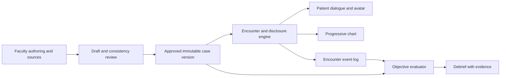

# Encounter design and implementation plan

Research recommendation, October 10, 2026. Nothing in this file is an implemented capability. See [meeting record](2026-10-10-virtual-patient-encounter.md), [challenge scope](challenge-scope.md), [clinical evidence](clinical-education-and-assessment.md), and [voice options](voice-and-avatar-integration.md).

## First useful encounter

A learner has up to ten minutes to interview one faculty-approved synthetic patient in the ED, review progressively disclosed chart information, clarify a case-authored inconsistency if one exists, and agree on an appropriate next step or summarize unresolved concerns. Select the actual case and clinical goals with faculty. Show a visible timer and keep the debrief outside the ten-minute encounter budget.

Support parallel students through isolated encounter IDs and state. Scalability, cost, educational improvement and patient realism must be measured rather than claimed from the design.

## One case, three consumers

The patient actor receives only currently releasable patient-known facts and behavior instructions. The chart receives released chart facts/artifacts. The evaluator may inspect the approved answer key server-side, but never expose it through the student client or patient voice. External providers, source documents and learner inputs cannot change approval status or backend permissions.

## Proposed domain contract

| Entity | Minimum useful content |
| --- | --- |
| CaseVersion | Case/version IDs; synthetic identity; setting; clinical fact IDs; unknown/known-negative states; patient-known versus chart-known data; source/permission references; review/approval status |
| Artifact | Artifact ID, type, case version, linked fact IDs, source/permission, release rule; absent assets explicitly unavailable |
| DisclosureRule | Trigger, required context, permitted fact/artifact IDs, approved wording/variants, state transition |
| BehaviorProfile | Baseline emotion, readiness to change, concerns, communication style, bounded difficulty and authored emotional cues |
| AuthoredDiscrepancy | Patient-reported claim, independently available evidence, reason/uncertainty, clarification trigger, learning objective; never an ad hoc model-generated lie |
| LearningObjective | Observable target behavior, relevant fact/event IDs, scoring anchors, applicability, feedback guidance and rubric version |
| Encounter | Learner and case/version IDs, mode, difficulty snapshot, start/end time, status, event sequence and disclosure state |
| EncounterEvent | Actor, turn ID, event type, timestamp, transcript status, visible/heard content, disclosed IDs, contradictions/clarifications, retry/interruption markers |
| Assessment | Objective, observed/missed/not-assessable result, evidence IDs, explanation, uncertainty, faculty correction and next-attempt suggestion |

Keep assessment content separate from learner-editable practice preferences. A faculty-published assignment pins case, objectives, rubric and difficulty. A learner-modified practice copy must be visibly different and must not silently replace an assigned version.

## Patient behavior and mood

Replace a single “grumpiness” knob with bounded controls such as frustration, anxiety, trust/guardedness and readiness to change. These are **simulation variables**, not psychological measurements. Preserve the patient's agency, concerns and reasons for hesitation. Faculty approves which emotional cues and disclosure changes are appropriate; warmth must not manufacture a clinical fact or guarantee disclosure.

An initial comparison can use receptive and guarded variants of the same approved case. Keep clinical facts identical, record the variant, and validate the intended difficulty difference with faculty. Avoid demographic shortcuts for mood, dishonesty, accent or cognitive ability. Do not rank learners across unmatched difficulty versions without a defensible comparison.

The notes' indirect-question examples can inspire case-specific exploration of routines, understanding, access and barriers. Vitamin brand or dental visits alone must not be treated as proof of vitamin deficiency. Teach respectful follow-up of contradictions, allowing uncertainty, poor recall and misunderstanding as alternatives to deception.

## Lifecycle and evaluation

Use a server-defined 600-second cap and a visible countdown. Decide before launch how silence, provider failure and interruptions affect the clock. At expiry, stop accepting new interview turns, settle already confirmed events according to the documented policy, freeze the encounter log and generate the debrief. The ten-minute cap should be configurable for later curricula.

A separate evaluator can consume confirmed events during the encounter to prepare **provisional** objective observations. It must not direct the patient to reward an answer, change clinical truth, or prematurely classify a finding as permanently missed. Reconcile against the final transcript and disclosure ledger after the encounter. Mark uncertain speech recognition and unobserved/nonapplicable behaviors explicitly.

Default assessed mode gives feedback after completion. An optional practice-hint mode may flag insufficient probing while the learner is working, but faculty must define it and reports must record that assistance. Students should understand which mode they are using.

Debrief structure: one supported strength; priority objectives and evidence; one missed or unresolved concern and why it matters within the approved case; a respectful alternative question; one concrete next-attempt goal. Quote only short relevant learner turns. If the student had no opportunity to observe a hidden cue or unreleased chart item, avoid claiming they “should have caught” it.

Report simulated rapport trajectory separately from observed communication behaviors. A mood increase is an engine output, not a validated empathy or alliance score. Any numeric rubric requires faculty-defined anchors, opportunity-adjusted applicability, calibrated raters and a version; start with behavioral results rather than an arbitrary 0–100 total.

## Data and EHR boundary

An original chart-style panel driven by the approved case is sufficient for this research recommendation. The recording's “Epic clone” claim is not verified. Epic provides official FHIR documentation and a testing sandbox with example data; this does not establish access to any hospital's production records. Future interoperability should follow documented APIs and authorized institutional access. [Epic on FHIR](https://fhir.epic.com/).

Synthea is an optional source of synthetic record structures and longitudinal data. It is not, by itself, a faculty-approved educational persona, a disclosure script, or evidence of the local ED case mix. Generated histories still need consistency review and scenario-specific learning objectives. [Synthea project](https://synthetichealth.github.io/synthea/).

Nutrition/wellness templates can inform common schema fields. Expanding to another specialty is new clinical authorship: provenance, artifacts, reasoning targets and communication constraints must be reviewed. AI case edits stay drafts until faculty approval; sources never become arbitrary execution instructions.

## Build sequence and acceptance checks

| Step | Concrete acceptance check |
| --- | --- |
| 1. Reviewed content | Faculty approves case facts, variants, artifacts, disclosure rules and rubric; provenance and reuse permissions recorded |
| 2. Faculty Studio | Create an unseen case, attach a source/artifact, define release timing, correct a draft and publish it without code changes |
| 3. Text encounter | Launch any approved version; reveal only permitted facts; preserve chart/dialogue agreement; keep two simultaneous sessions isolated |
| 4. Event/evaluator loop | Show transcript/disclosure evidence for strengths, omissions and uncertainty; retrying an event does not duplicate credit; evaluator never leaks answer key |
| 5. Voice/visible avatar | Confirm actual heard speech, interruptions, stable voice, lip-sync behavior if included, keyboard/text access and provider outage fallback |
| 6. Assessment calibration | Faculty independently labels objectives on completed encounters, reviews disagreements and records rubric changes; publish observed results and limitations |
| 7. Demo/readiness | Faculty creates a held-out patient and immediately completes encounter plus debrief; four-minute pitch shows reusability and limitations |

For a finite grounding check, probe approved known facts, missing facts, paraphrases and contradiction handling. Record the sample size and observed unsupported claims; a zero-failure test result would not prove hallucination-free operation. Include a hostile learner prompt that asks the patient to reveal the answer key or change a lab value.

Measure concurrent completion/failure counts, authoring time, response/debrief latency, cost per completed encounter and feedback disagreements. No prototype benchmarks were performed by this documentation task.

## Subsequent modules

Assignments/analytics can follow the reusable encounter. Longitudinal patient memory needs explicit continuity and version rules; it is different from unlimited model context. Demonstration mode can show faculty-scripted helpful and unhelpful clinician responses. Hard-news practice needs a separate reviewed communication scenario and rubric, including what the patient understands, what they want to know, response to emotion, comprehension checking and next steps. Do not infer a cancer diagnosis from generated findings or present such a module as validated counseling training.
