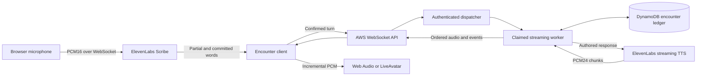

# Streaming encounter backend

The encounter pipeline uses live microphone transcription and incremental reply audio. Faculty authoring, authentication, case publication, ledger reads, and feedback remain ordinary authenticated HTTP APIs. Streaming does not change the approved case facts or make patient answers unconstrained model output.

## Setup

Use the deployment command in [the infrastructure guide](../infra/README.md). The existing HTTP app URL stays the same. CloudFormation adds a WebSocket API and a separate streaming Lambda sharing the encrypted records table and code artifact. The HTTP Lambda keeps its own concurrency allocation so sign-in, cancellation, and conclusion remain available during streaming work.

The server-only ElevenLabs key needs Text to Speech and Speech to Text access; read-only Voices access supports the existing setup. Keep the provider key out of frontend configuration, Git, screenshots, and diagnostics. Enable `--enable-stt` only after verifying that key can mint a realtime Scribe token. The application keeps short-lived credentials in browser memory and never persists Scribe tokens in the ledger.

`CASECLIMB_STREAM_WS_URL`, `CASECLIMB_STREAM_MANAGEMENT_URL`, `CASECLIMB_STREAM_FUNCTION_NAME`, and `CASECLIMB_APP_ORIGIN` are derived by CloudFormation. `CASECLIMB_STT_ENABLED` enables native realtime transcription, and `CASECLIMB_STT_SECOND_BUDGET` sets the durable lifetime reservation allowance. Existing TTS, Bedrock, session, and free video allowances remain in effect across deployment.

## HTTP setup and recovery

Every route requires the app entrance session and the encounter's bearer token. Setup and cancellation reject a foreign request origin.

| Route | Result |
| --- | --- |
| `POST /api/encounters/{id}/stream-ticket` | Single-use WebSocket connection URL, 60-second ticket expiry, encounter deadline, protocol identifier |
| `POST /api/encounters/{id}/speech/token` | Single-use Scribe token, fixed model and PCM input format, encounter deadline and reserved seconds |
| `POST /api/encounters/{id}/stream-cancel` | `{request_id}` cancels the named output job and releases its pending turn reservation |
| `GET /api/encounters/{id}` | Authoritative confirmed transcript and pending turn state after reconnect or uncertain delivery |

The connection ticket is bound to the exact app origin, entrance session, encounter, token hash, and a connection generation. `$connect` consumes it using a conditional write. Each job and audio chunk rechecks connection ownership, entrance-session revocation, and the encounter deadline. Replacing a connection invalidates the old connection's ability to dispatch or cancel new work.

## Streaming protocol

Clients send JSON messages with an `action`:

| Action | Fields | Behavior |
| --- | --- | --- |
| `turn` | `request_id`, `text`, `audio` boolean | Commit one confirmed learner turn, return the authored patient event, optionally stream speech |
| `speak` | `request_id`, `event_id` | Stream a stored patient event; explicit successful replay uses cached PCM |
| `cancel` | `request_id` | Interrupt the named job; the independent HTTP cancellation route also works if streaming capacity is occupied |
| `ping` | None | Return server time without a provider call |

Server messages carry a `type`:

| Type | Meaning |
| --- | --- |
| `turn.confirmed` | The patient event and turn are durably stored. Includes current state; large ledgers use an authenticated HTTP state refresh |
| `audio.start` | Utterance and event IDs, `pcm_s16le`, 24,000 Hz, one channel, deadline |
| `audio.chunk` | Matching IDs, strictly increasing zero-based `sequence`, base64 PCM bytes |
| `audio.end` | Generation completed, chunk count and audio duration |
| `stream.error` | Fixed application message and error category, without provider diagnostics or credentials |
| `pong` | Server time |

PCM frames contain at most 8,192 bytes before base64 encoding. Complete messages stay below API Gateway's 32 KB frame limit. Large transcripts stay available through the HTTP ledger instead of overflowing a WebSocket frame. Backend speech consumption uses the provider's streaming response iterator and forwards chunks before the provider finishes. It also caches small PCM groups for explicit replay; it does not wait for the cache to fill before sending the first chunk.

`audio.end` means synthesis ended. The client waits for queued Web Audio playback to drain or the matching LiveAvatar utterance-end event before reporting that the reply finished. These are distinct from a provider buffer acknowledgement.

## Interruption and recovery

Scribe partial transcripts appear as captions and can interrupt a reply. Only committed transcripts submit turns. Microphone capture remains available while reply audio plays, with browser echo cancellation enabled. A spoken interruption stops local playback immediately and cancels the durable output job; a previously confirmed transcript entry remains confirmed. At most one next committed phrase waits for the previous reservation to settle.

The dispatcher reserves a job before asynchronously invoking the worker. The worker claims it once. Lambda asynchronous retries are disabled, and failed or uncertain provider attempts remain charged to their reserved allowance. Turn IDs remain bound to content; repeating an uncertain request does not authorize another synthesis call. Cancellation writes a tombstone and releases the turn nonce in the same ledger revision, preventing a late worker from confirming an interrupted turn.

Disconnect, page hiding, pause, session ending, and expiry close capture and playback. Reconnect refreshes authoritative state and uses a fresh connection ticket. Old captured speech and partial audio are never automatically replayed. Failed or interrupted synthesis requires an explicit user action, while completed cached speech can be replayed without another provider charge.

## Bounds and provider limits

Encounters retain the ten-minute deadline, sixty-turn limit, authored clinical truth, and separate entrance/encounter authorization. Workers have a bounded processing deadline with cleanup grace. Speech streams contain at most thirty seconds of PCM and preserve 16-bit sample alignment. Connection, request, audio, and transcript records retain the existing 24-hour TTL policy; deployment-wide quota counters have no TTL.

The Scribe token expires after fifteen minutes for connection initiation. It does **not** bind an already-open provider connection to our encounter or revoke it server-side. The normal client enforces pause and encounter deadlines, and the server reserves the entire remaining session duration before minting each token. These are application controls, not a hard provider-duration ceiling. The scoped ElevenLabs key's credit cap is the independent spending ceiling. A persistent server relay would be required for hard upstream audio-duration enforcement against a modified client.

Live video remains the free LiveAvatar Wayne sandbox, capped at roughly one minute with a shared rendered face. Patient cases retain their authored words, configured voice, and illustration. ElevenLabs supplies transcription and expressive voice; LiveAvatar renders live video. The native ElevenLabs Image & Video introduction is prerecorded. The unified patient-case interface requires a reviewed, published case and student access code before an encounter can start; communication templates are editable drafts, not automatically approved cases.

## Verification

Tests exercise incremental output before provider EOF, sample alignment, bounded frames, one-time tickets, concurrent job claims, durable duplicate rejection, interruption during reservation and playback, revoked entrance sessions, expiry, large-ledger refresh, reconnect, and session-ending guards. Actual AWS/provider acceptance is recorded separately in [implementation and verification](implementation-and-verification-2026-10-10.md); local tests alone do not prove cloud transport or a physical microphone conversation.

Primary references: [ElevenLabs streaming TTS](https://elevenlabs.io/docs/api-reference/text-to-speech/stream), [Scribe realtime protocol](https://elevenlabs.io/docs/api-reference/speech-to-text/v-1-speech-to-text-realtime), [single-use tokens](https://elevenlabs.io/docs/api-reference/tokens/create), [AWS WebSocket limits](https://docs.aws.amazon.com/apigateway/latest/developerguide/apigateway-execution-service-websocket-limits-table.html), [AWS connection callbacks](https://docs.aws.amazon.com/apigateway/latest/developerguide/apigateway-how-to-call-websocket-api-connections.html).
